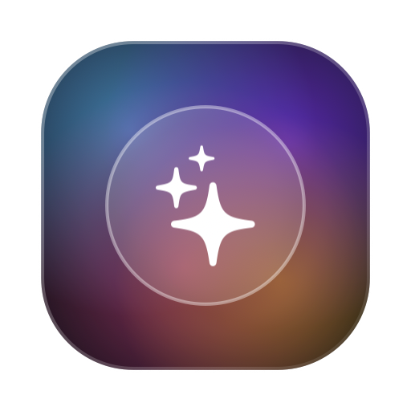
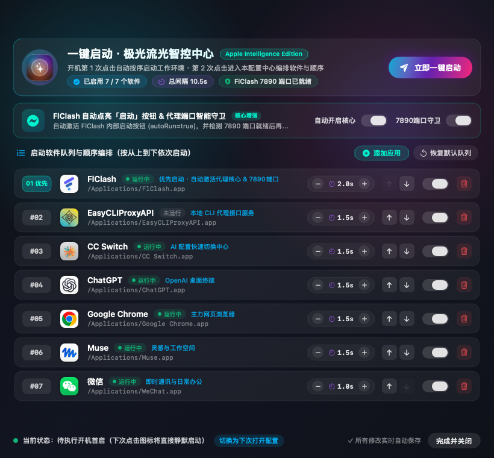
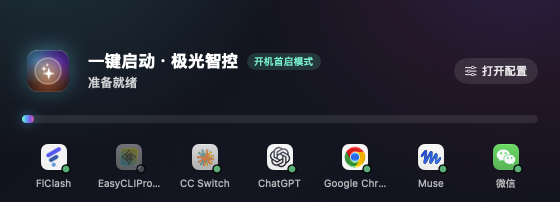

# 一键启动 · 极光流光智控中心 (OneClickLauncher)

<p align="center">
  
</p>

<p align="center">
  <b>专为 macOS 设计的现代化顺序启动与流光智控管理工具</b><br>
  原生 Swift / SwiftUI 开发 · Apple Intelligence 极光流光美学 · 开机首启/配置智能双模式 · 代理核心自启守卫
</p>

---

## 🌟 核心特性

- 🚀 **按序拉起应用（Sequential Launch）**
  - 支持自定义任意多个 `.app` 应用程序的启动先后顺序。
  - 支持为每个应用精确配置 0.5s ~ 15s 的启动间隔延时，避免多应用并发启动争抢 CPU/IO 与网络。
- 🔮 **开机首启与二次配置智能双模式（Dual Boot Mode）**
  - **开机第 1 次点击**：自动识别为系统冷启动首次执行，屏幕中央以极光流光 HUD 迷你悬浮条展示进度，按序静默启动全部启用软件，拉起完毕后自动秒退，无冗余干扰。
  - **同开机第 2 次（及后续）点击**：系统检测到今日开机已执行过一键启动，直接弹开全功能的 **「极光流光智控中心」** 可视化配置面板。
  - **双向随心切换**：可在配置面板底部一键切换当前状态，或在点击图标时按住 `Option (⌥)` 强制进入配置面板。
- 🛡️ **FlClash 自动点亮启动按钮 & 代理端口智能守卫**
  - 启动前自动检查并配置 `autoRun = true`，使 FlClash 打开时自动点亮内部启动核心，无需人工手动点击。
  - 支持轮询检测 `127.0.0.1:7890` 本地代理端口，直到端口畅通后再依次拉起后续依赖代理的应用（如 ChatGPT、Google Chrome 等）。
- 🎨 **Apple Intelligence 极光流光视效**
  - 原生 macOS 13+ SwiftUI 实现，深色磨砂玻璃、极光渐变发光描边、平滑 Spring 弹性动画。
  - 实时显示本地各应用运行状态（运行中 / 未运行）与端口就绪状态。
  - 支持在界面中快速启用/停用、移动调整顺序、增减延时、通过文件选择器添加任意新应用、删除应用与一键恢复默认。
- 🔒 **严格本地化与隐私安全（Zero Telemetry）**
  - 零网络上报、无埋点、不读取任何用户敏感隐私。
  - 配置文件保存在用户本地 `~/.config/oneclick_launcher/config.json`，支持原子保存与安全隔离。

---

## 🖼️ 界面预览

### 1. 极光流光智控中心（配置面板）
> 开机第 2 次点击打开，自由编排软件队列、顺序与延时。



### 2. 开机首启迷你 HUD（静默启动）
> 开机第 1 次点击打开，轻量进度指示，启动完成后秒级退出。



---

## 🛠️ 构建与安装

### 系统要求
- macOS 13.0 (Ventura) 或更高版本
- Xcode 14+ 或 Command Line Tools (`xcode-select --install`)
- Swift 5.7+

### 快速一键构建 `.app`
在项目根目录下执行打包脚本：

```bash
chmod +x ./scripts/build_app.sh
./scripts/build_app.sh
```

构建成功后，将在 `build/` 目录下生成完整的 `一键启动.app`。您可以直接双击运行或复制到 `/Applications/`：

```bash
cp -R "build/一键启动.app" /Applications/
```

### 开发者命令行编译
使用 Swift Package Manager 单独构建命令行二进制：

```bash
# Debug 构建
swift build

# Release 生产构建
swift build -c release
```

---

## ⚙️ 配置文件说明

应用程序在首次运行后，将在用户主目录生成配置文件：
`~/.config/oneclick_launcher/config.json`

示例结构可参考项目中的 [config.example.json](config.example.json)：

```json
{
  "apps": [
    {
      "id": "flclash",
      "name": "FlClash",
      "path": "/Applications/FlClash.app",
      "bundleId": "com.follow.clash",
      "enabled": true,
      "delaySeconds": 2.0,
      "note": "优先启动 · 自动激活代理核心 & 7890端口"
    },
    {
      "id": "chatgpt",
      "name": "ChatGPT",
      "path": "/Applications/ChatGPT.app",
      "bundleId": "com.openai.codex",
      "enabled": true,
      "delaySeconds": 1.5,
      "note": "OpenAI 客户端"
    }
  ],
  "autoStartFlClashCore": true,
  "flClashPort": 7890,
  "waitForFlClashPort": true,
  "lastLaunchedBootId": ""
}
```

---

## 📄 开源许可证

本项目基于 [MIT License](LICENSE) 开源发布。
